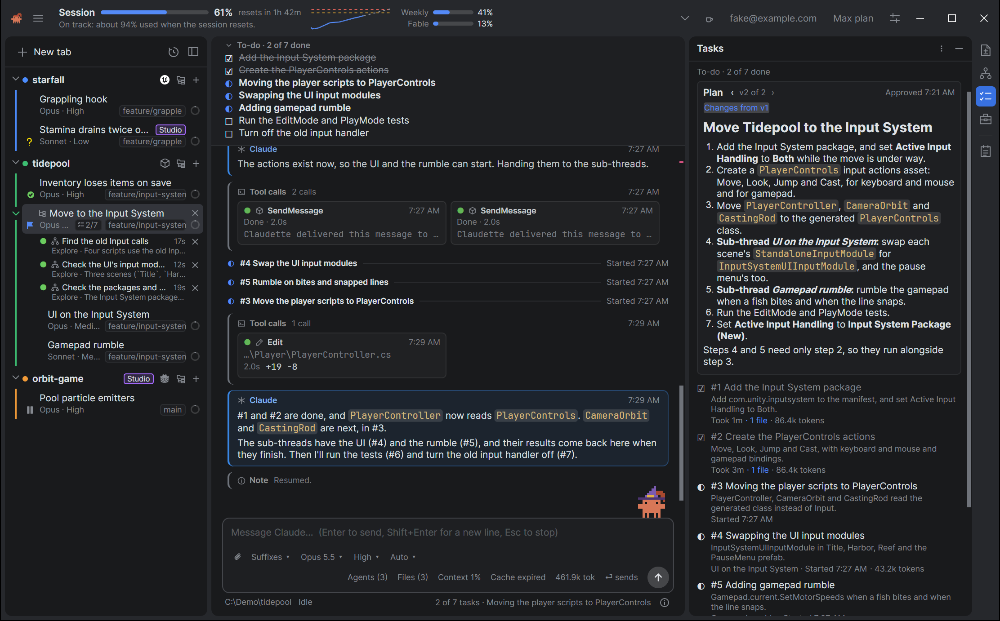
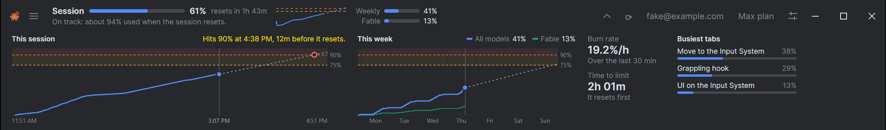
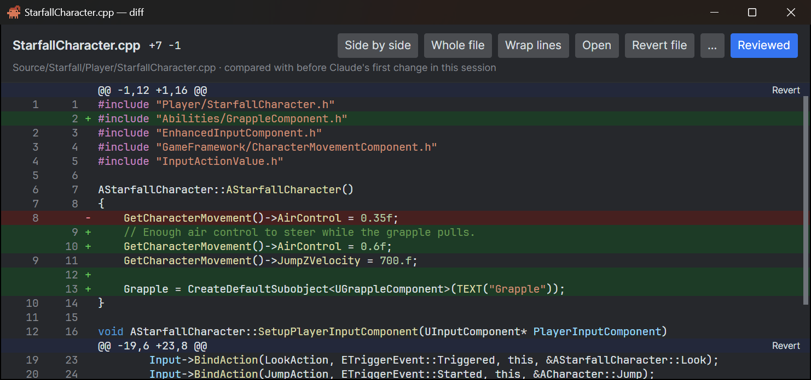
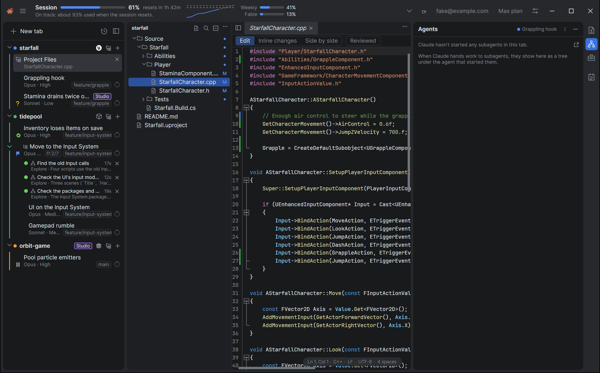
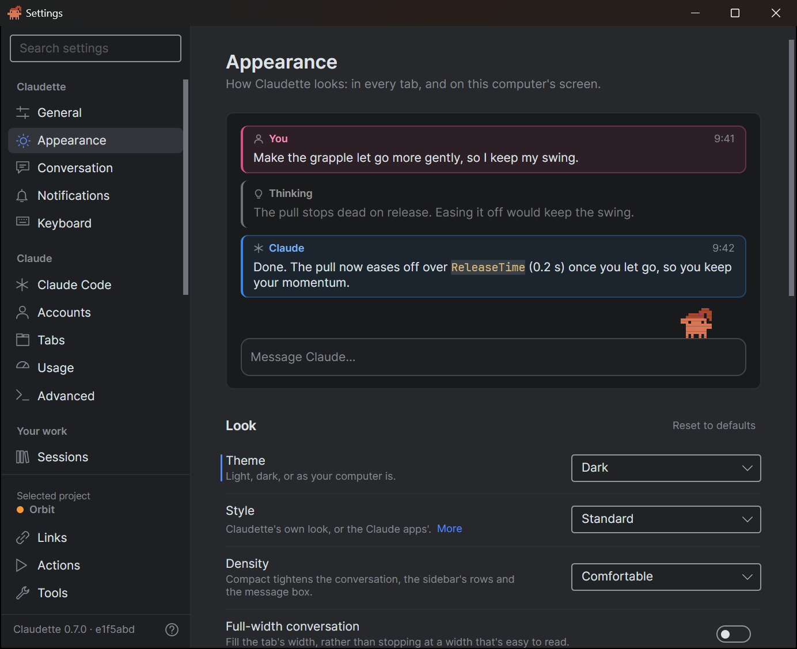

# Claudette

> This was made for our own usage, its not meant for everyone and is opinionated. The core pillar is to minimize token usage by default.

**Your friendly neighborhood Claude Code wrapper.** Claudette puts [Claude Code](https://code.claude.com/docs) in a real desktop window: every session in its own tab, every change ready to review, and your plan's usage on screen the whole time, so you never have to run `/usage` again.

It isn't a reimplementation. Each tab runs the real `claude` CLI, with your settings, `CLAUDE.md`, MCP servers, hooks and permissions, and Claudette draws it as proper native UI instead of a terminal. It runs on Windows, macOS and Linux (from source for now), and every change is built and tested on all three. Built with .NET 10 and Avalonia.

**[claudette.dotbunny.com](https://claudette.dotbunny.com)** · [Download](https://claudette.dotbunny.com/downloads/) · [The user guide](https://claudette.dotbunny.com/guide/) · [Changelog](CHANGELOG.md)


## What it does

The [website](https://claudette.dotbunny.com) has the tour, and [the guide](https://claudette.dotbunny.com/guide/) shows how to use every part of it. In short:

### Run a dozen sessions without losing track of any

One tab per session, grouped by project, each showing at a glance whether it's busy, waiting for you or done, with its branch, model and a ring for its context. `Ctrl+J` jumps to the next tab waiting for you, tabs open side by side, and worktree tabs give parallel sessions in one repository a branch each. [Tabs and sessions →](https://claudette.dotbunny.com/tabs/)

### Plans, tasks and threads

The Tasks page follows Claude's plan as it writes it and every task it makes from it. Threads spread one job over several tabs: Claude hands work to the sub-threads with Claude Code's own `SendMessage`, and their results come back in one message. The agent map shows subagents as a tree while they fan out. [Plans, tasks and agents →](https://claudette.dotbunny.com/plans/) · [Threads →](https://claudette.dotbunny.com/threads/)



### Know how fast you're burning your plan

Live meters for the session, the week and each model's limit, with a projection: *"At this rate you'll hit the limit in 1h 05m"*. Open the header up for the charts, your burn rate and the tabs burning the most. Hit the limit mid-task, and the tab carries on by itself when it resets. [Usage and limits →](https://claudette.dotbunny.com/usage/)



### Your plan for your projects, their API key for theirs

Run a project's tabs on an API key kept in your OS's credential store, and see what it's spending today, this week and this month. [Accounts →](https://claudette.dotbunny.com/accounts/)

### Review every change Claude makes

Changed files, live, a real diff view with **Revert** for a hunk or a file, and ticks for what you've reviewed. Or send the diffs to your own tool. [Reviewing changes →](https://claudette.dotbunny.com/changes/)



### Your project's files, with Claude's changes marked

Open a project's files in a tab beside its sessions: an explorer, and an editor with your language's colors, find and replace, and a bar in the gutter beside every line Claude changed. Click one for the lines it replaced and **Revert**, or switch the file to a diff and back. It's for reading what Claude wrote and fixing a line of it, not an IDE. [Project files →](https://claudette.dotbunny.com/project-files/)



### Settings that say what they do

Each setting has a line saying what it does, and the search finds it by what you'd call it: "dark mode" finds **Theme**. Changes apply as you make them, each section has its own **Reset to defaults**, and Appearance shows your choices in a preview as you pick them. The window stays open beside your work, so you can see what a change does. [The Settings window →](https://claudette.dotbunny.com/settings/the-settings-window/)



### And the rest

- **A conversation built for code:** cards in their own colors, tool calls side by side as tiles, permission prompts and plans as cards, rewind and branch, find and export. [The conversation →](https://claudette.dotbunny.com/conversation/) · [The composer →](https://claudette.dotbunny.com/composer/)
- **Pick up anywhere:** History searches Claude's replies too, the session library syncs sessions between your machines, and Remote Control carries a tab on in the Claude app on your phone. [History and syncing →](https://claudette.dotbunny.com/history/)
- **It knows your project:** tools for Unreal Engine, Unity and Godot, the processes a tab started, MCP servers, and Perforce. [Project tools →](https://claudette.dotbunny.com/project-tools/)
- **Two looks, light and dark:** Standard, dense and calm, and Claude, after the Claude apps. [Styles and themes →](https://claudette.dotbunny.com/settings/styles-and-themes/)

<table>
  <tr>
    <td></td>
    <td></td>
  </tr>
  <tr>
    <td align="center">Standard, light</td>
    <td align="center">Claude, dark</td>
  </tr>
</table>

### Claudette keeps you company


Claudette, the app's pixel mascot, stands on the message box while you work: she hammers while Claude edits, juggles a ball for each subagent, waves when Claude needs you and throws confetti when the task list is done. [Meet her →](https://claudette.dotbunny.com/claudette/)

## Getting started

You need [Claude Code](https://code.claude.com/docs) installed. Claudette finds `claude` on your `PATH`, and can sign you in if you aren't already. The guide's [Getting started](https://claudette.dotbunny.com/getting-started/) takes you through it.

- **Windows:** the MSIX from the [Downloads page](https://claudette.dotbunny.com/downloads/).
- **macOS:** the `.dmg` from the [Downloads page](https://claudette.dotbunny.com/downloads/).
- **Linux:** build it from source, as below. [Installing on Linux](https://claudette.dotbunny.com/getting-started/installing-on-linux/) goes step by step, from installing .NET to a launcher in your app menu.
- **From source** (Windows, macOS or Linux), with the .NET SDK that `global.json` names:

  ```sh
  dotnet run --project src/Claudette.App
  ```

### Try it without an account

`tools/Claudette.Demo` builds a demo, the one in these screenshots: three game projects (Unreal in C++, Unity in C#, and Godot), seven tabs including a thread with two sub-threads and two on a studio's API key, past sessions for History, and a usage history, with a stand-in for Claude Code. It needs no account and spends no tokens.

```sh
dotnet run --project tools/Claudette.Demo -- <empty folder>
```

It prints the environment variables to start Claudette with. On Windows, `tools/Claudette.Demo/screenshots.ps1 -Projects C:\Demo` takes these screenshots again.

## Getting help

The [user guide](https://claudette.dotbunny.com/guide/) shows how to use every part of Claudette. Ask questions on [dotBunny's Discord](https://claudette.dotbunny.com/discord/), and report problems in [GitHub issues](https://github.com/dotBunny/Claudette/issues): **Report an issue**, at the foot of Claudette's Settings, starts one with the versions filled in.

## Contributing

[DESIGN.md](DESIGN.md) is the spec for every feature, and [CLAUDE.md](CLAUDE.md) covers the layout, rules and commands. The tests never touch a real account: they use a fake Claude Code, a mock Messages API and recorded protocol fixtures.

```sh
dotnet build Claudette.slnx
dotnet test Claudette.slnx --filter "Category!=Live"
```

## License

[MIT](LICENSE)
