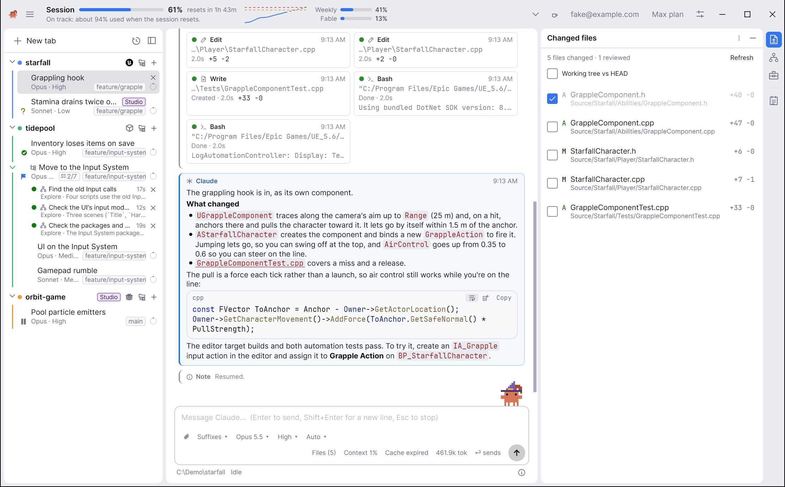
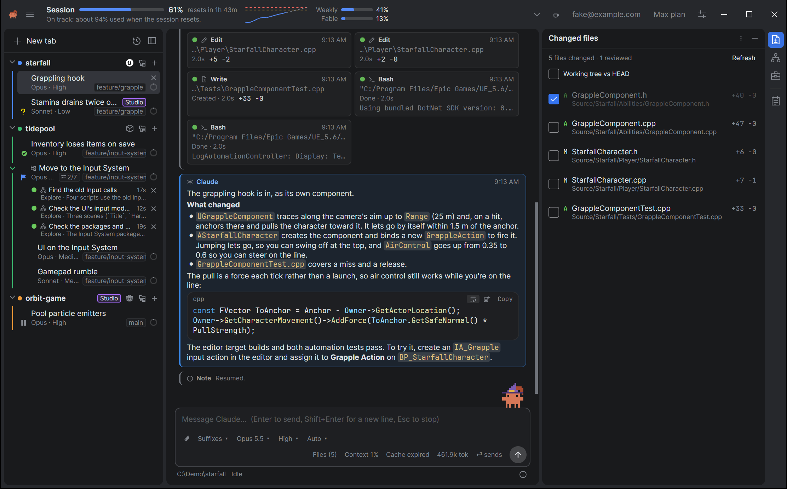
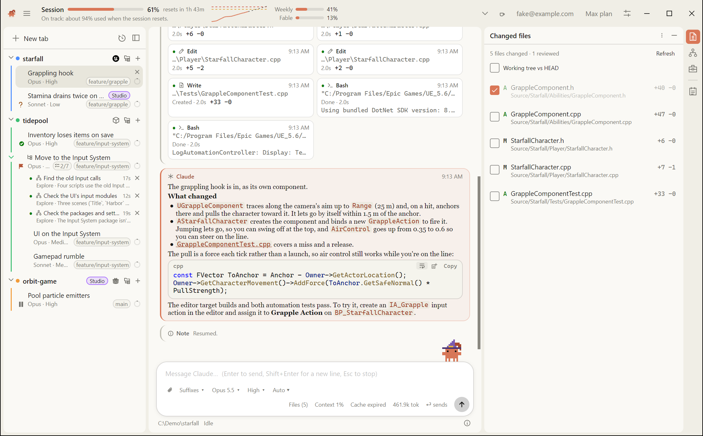
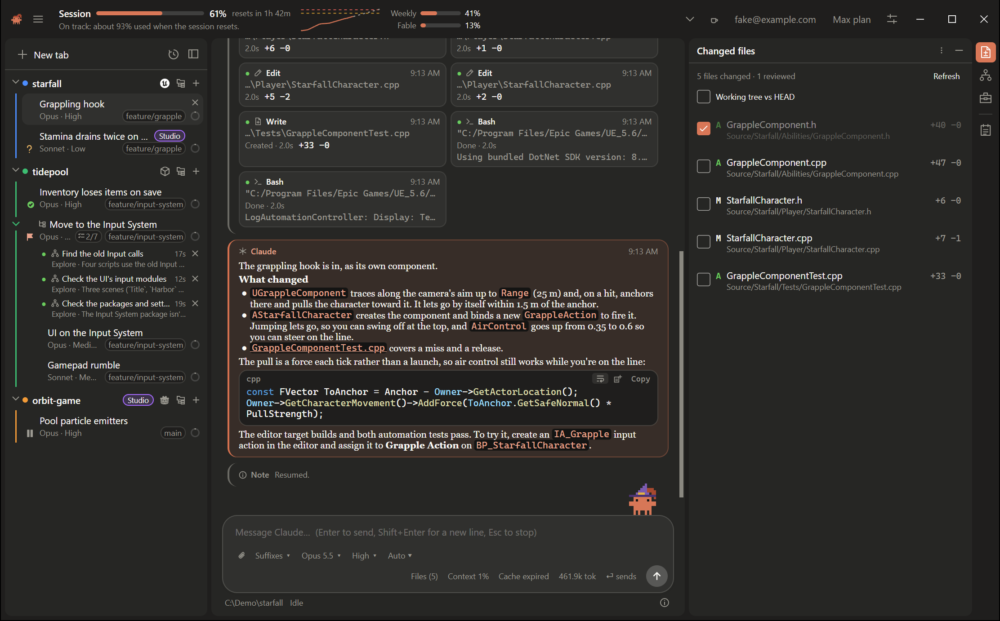

# Styles and themes

Claudette has two looks, Standard and Claude, and each comes in light and dark. You pick the look with **Style** and the light or dark with **Theme**, in Settings → Appearance. Both change at once, with no restart. The preview at the top of the page, a little of a tab with Claudette on its message box, follows each choice as you make it.



## Theme

Settings → Appearance → **Theme** is **System**, **Light** or **Dark**. **System**, the default, follows your OS and changes when it does.

## Style

Settings → Appearance → **Style** is **Standard** (the default) or **Claude**. The layout, the tool rows, the diffs and every control are the same in both. So are the islands: the sidebar, each pane and each tool window are rounded panels with a gap between them, on the window's frame, which the header and the strip of tool window icons sit on. The look changes.



**Standard** takes JetBrains Rider as its reference, in its Islands colors: a grey frame with darker panels in dark, white panels on light grey in light, and Rider's blue for selection, the usage meters, checked boxes and the icon of a tool window showing. Its type is Rider's too, Inter for the interface and JetBrains Mono for code, which come with Claudette, so it looks the same on every system. The conversation keeps the dense, calm layout of Claude Code's extension for Visual Studio Code: diffs are inline, in red and green, and code takes Visual Studio Code's Light+ and Dark+ colors. The composer is a rounded box, and Send and Stop are round buttons: an arrow in the accent color, and a square.



**Claude** takes the Claude apps (the iOS app and claude.ai) as its reference:

- **Colors** from the Claude apps. In light, ivory panels on a warmer frame, white cards and composer, and near-black text. In dark, charcoal panels on a darker frame, and lighter cards. The accent is Claude's orange, including the working line's glyph and verb and the Send button.
- **Cautions are warm tints of the orange**, not yellow: a waiting prompt, a usage alert, *Needs your input*. Errors, diffs, the charts' model lines and a folder group's own color keep their usual colors.
- **Claude's replies are set in a serif**, as in the Claude apps. Their typeface isn't available, so Claudette uses the closest installed one: Charter on macOS, Georgia or Cambria on Windows, and Charter, Noto Serif or DejaVu Serif on Linux. A conversation font you pick in Settings wins.
- **A bigger composer**, a big rounded box lifted a little off the page, and rounder corners on the cards, code blocks and the sidebar's rows.
- **Your system's interface font**, rather than Standard's Inter.

All four, side by side:

|  |  |
|:---:|:---:|
| Standard, light | Standard, dark |
|  |  |
| Claude, light | Claude, dark |

## The conversation's colors

Each step in the conversation is a card with a stripe down its left edge in its kind's color. The style changes the colors, so what the cards mean stays the same:

| Card | Standard | Claude |
|---|---|---|
| Your messages | Magenta | Warm grey |
| Claude's replies | Blue | Orange |
| The files a turn changed | Green | Blue, which stays apart from the orange with color blindness |

Tool calls, thinking, subagents and notes are neutral in both, and a turn's statistics are slate. [Reading the conversation](../conversation/reading-the-conversation.md) explains the cards.

## Density

Settings → Appearance → **Density** is **Comfortable** (the default) or **Compact**. Compact tightens the conversation's spacing, the padding of messages and cards, the tool rows, the sidebar's rows and the composer's padding, so more fits on screen.

## The title bar

On Windows and macOS the header is the window's title bar, as in JetBrains Rider: Claudette's logo, the menu, your usage, then the window's buttons. Settings → Appearance → **Use the system's title bar** puts your system's title bar over the header instead. It's this computer's, so it doesn't sync, and Linux always has the system's. See [A tour of the window](../getting-started/a-tour-of-the-window.md#the-header).

## Fonts

Four settings in Settings → Appearance choose the type:

- **Conversation font** and **Conversation font size** (9 to 28, 14 by default) for the conversation, which includes the Markdown in replies.
- **Code font** and **Code font size** (8 to 28, 13 by default) for code blocks, commands and diffs.

Pick a font from the list of the ones installed, or type a name. Leave a font empty for the default: Claudette's own font, and Cascadia Mono, Consolas or Menlo for code. A font that isn't installed on this machine falls back to the default.

[Zoom](accessibility.md#zoom) scales everything in the main window, fonts included.

## What the tab rows show

Three switches decide what a tab's row in the sidebar carries, beside its status icon: two in Settings → Conversation → Tab rows, and the branch's in Settings → Git → Tab rows. [The sidebar](../tabs/the-sidebar.md) explains the rest of the row.

- **Show context** puts a small ring on the row that fills as the tab's context window does. It turns amber when Claude Code is about to compact the conversation, and red when it's nearly full ([Context and compacting](../usage/context-and-compacting.md)).
- **Show the git branch** shows the branch the tab's folder has checked out, such as `main`, at the right of the row's second line. A tab in a worktree shows the worktree's name instead. It's on the [Git](git.md) page, with the rest of what Claudette does with git.
- **Show task progress** shows how many of Claude's tasks are done, such as `3/7`, at the right of the second line, and the task Claude is working on in place of the model while it works ([The Tasks page](../plans/the-tasks-page.md)).

All three are on by default.

## Settings

All of these sync to your other machines when [settings sync](../history/settings-sync.md) is on.

| Setting | Default | Where |
|---|---|---|
| **Theme** | System | Settings → Appearance |
| **Style** | Standard | Settings → Appearance |
| **Density** | Comfortable | Settings → Appearance |
| **Conversation font** | Claudette's default | Settings → Appearance |
| **Conversation font size** | 14 | Settings → Appearance |
| **Code font** | Cascadia Mono, Consolas or Menlo | Settings → Appearance |
| **Code font size** | 13 | Settings → Appearance |
| **Show context** | On | Settings → Conversation → Tab rows |
| **Show the git branch** | On | Settings → Git → Tab rows |
| **Show task progress** | On | Settings → Conversation → Tab rows |

## See also

- [Accessibility](accessibility.md) for **Zoom** and **Motion**, which are on the same page of Settings.
- [Reading the conversation](../conversation/reading-the-conversation.md) for **Full-width conversation**, in Appearance, and **Quieter in-between steps**, in Conversation.
- [Claudette on the composer](../claudette/claudette-on-the-composer.md) for her settings, which are in Appearance too.
